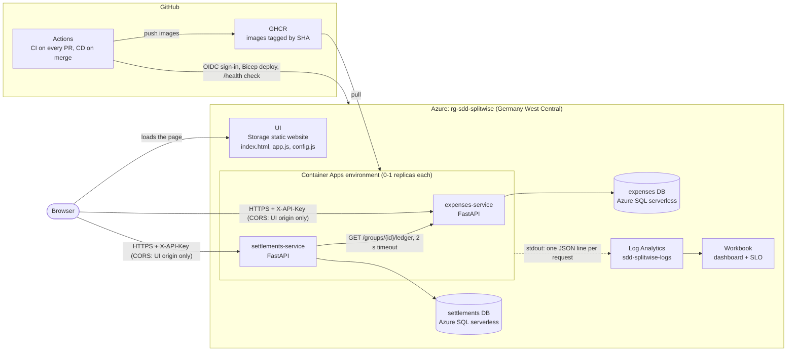

# Splitwise-lite

Group project for the Software Development and DevOps course (BCSAI, IE University).
A web app where a group logs shared expenses and sees the fewest transfers needed to settle up.

**Live URL:** https://stuirahgkb56ldciu.z1.web.core.windows.net (deployed by CD on every merge to `main`)

**Backlog (GitHub Project):** https://github.com/users/athulgokuldas22/projects/3

## Architecture

Two FastAPI services, each in its own container with its own database. A static UI calls both from the browser.

| Part | Folder | Owns | Local port |
| --- | --- | --- | --- |
| expenses-service | `services/expenses` | groups, members, expenses, shares | 8001 |
| settlements-service | `services/settlements` | payments, balances, settle-up | 8002 |
| UI | `ui` | static HTML + JS | 8080 |

settlements-service reads each group's ledger from expenses-service over HTTP.
Each service is layered: `app/api` (HTTP) → `app/domain` (business rules) → `app/db` (persistence).



## Run locally

Requires Docker.

```bash
docker compose up --build
```

- expenses: http://localhost:8001/health and http://localhost:8001/docs
- settlements: http://localhost:8002/health and http://localhost:8002/docs
- UI: in a second terminal, `python3 -m http.server 8080 -d ui`, then open http://localhost:8080

Migrations run automatically when each service starts.

## Run the tests

```bash
cd services/expenses   # or services/settlements
python3 -m venv .venv && source .venv/bin/activate
pip install -r requirements.txt -r requirements-dev.txt
ruff check . && ruff format --check .
pytest   # fails under 70% coverage
```

## Configuration

Every service reads its config from environment variables only. See `.env.example`.

| Variable | Used by | Meaning |
| --- | --- | --- |
| `SERVICE_NAME` | both | `expenses` or `settlements` |
| `DATABASE_URL` | both | SQLAlchemy URL (`mssql+pyodbc://…`) |
| `API_KEY` | both | demo key, sent as `X-API-Key`; empty disables the check |
| `CORS_ORIGIN` | both | the UI's origin |
| `EXPENSES_URL` | settlements | base URL of expenses-service |

## Adding a migration

```bash
cd services/expenses
alembic revision -m "create groups table"   # then edit the file in migrations/versions/
```

## Workflow

- Branch from `main`, open a pull request, get one approval. No direct pushes to `main`.
- CI must be green. Follow the [Definition of Done](docs/scrum/definition-of-done.md).
- Add a row to [AI_USAGE.md](AI_USAGE.md) for significant AI-assisted work.

## Azure setup

Everything runs in one resource group, `rg-sdd-splitwise`, in Germany West Central, defined in
[`infra/main.bicep`](infra/main.bicep). Nothing is created by hand except the one-time bootstrap below.

| Resource | Name | Notes |
| --- | --- | --- |
| Container App | `sdd-splitwise-expenses` | public HTTPS, scales 0–1 replicas |
| Container App | `sdd-splitwise-settlements` | same, plus `EXPENSES_URL` |
| Container Apps environment | `sdd-splitwise-env` | sends container stdout to Log Analytics |
| Log Analytics workspace | `sdd-splitwise-logs` | table `ContainerAppConsoleLogs_CL`, see [queries](docs/monitoring/queries.md) |
| Azure SQL server | `sdd-splitwise-sql-…` | databases `expenses` and `settlements`: serverless, free offer, auto-pause after 1 h |
| Storage account | `stui…` | static website that serves `ui/` |

Azure for Students only allows five regions (Spain Central, Norway East, Germany West Central,
Italy North, Poland Central). That decided two things:

- The UI is a Storage static website, not a Static Web App, because Static Web Apps is not
  offered in any of those regions.
- Everything runs in Germany West Central, because the Azure SQL free offer is not available
  in Spain Central.

### How a deploy works

[`cd.yml`](.github/workflows/cd.yml) runs after CI passes on `main`. You can also start it
from Actions → CD → Run workflow.

1. Build both images and push them to GHCR, tagged with the commit SHA.
2. Sign in to Azure with OIDC. There is no stored Azure password.
3. Deploy `infra/main.bicep` with the new images. Each container runs its migrations on startup.
4. Poll `/health` on both services for up to 5 minutes. The run fails if either never returns 200.
5. Write `config.js` with the service URLs and API key, and upload `ui/` to the static website.
6. Check that the UI and its `config.js` load (retries for up to 5 minutes).

### Secrets

They live only in the GitHub environment `production` (deploys from `main` only) and in
Container App secrets, never in the repo or the images.

| Name | Kind | Meaning |
| --- | --- | --- |
| `AZURE_CLIENT_ID`, `AZURE_TENANT_ID`, `AZURE_SUBSCRIPTION_ID` | variable | the deploy identity GitHub signs in as |
| `AZURE_RESOURCE_GROUP` | variable | `rg-sdd-splitwise` |
| `SQL_ADMIN_PASSWORD` | secret | Azure SQL admin password, generated |
| `API_KEY` | secret | shared demo key, generated; the UI sends it, so it is visible in the browser |

### One-time bootstrap

Already done for `rg-sdd-splitwise`. To set it up again, from the repo root, with Owner on the
subscription and admin on the repo:

```bash
az login && gh auth login
./infra/bootstrap.sh                    # add --rotate-secrets to generate new secrets
```

It creates the resource group, a managed identity that trusts GitHub's OIDC tokens for the
`production` environment only (Contributor on this resource group), the GitHub environment,
and its variables and secrets. After rotating secrets, run CD again.

### Cold starts

Both services scale to zero and the databases auto-pause, so the first request after a quiet
spell can take up to a minute or two. Settlements calls expenses with a 2 s timeout, so the first
balances call after idle may return 503 ("try again shortly"); the next one works. Open the UI a
minute before a demo.

## Monitoring

Both services write one JSON line per request to stdout (`service`, `method`, route
template as `path`, `status`, `duration_ms`). The Container Apps environment sends it to the
`sdd-splitwise-logs` Log Analytics workspace (table `ContainerAppConsoleLogs_CL`).

- **Dashboard:** the Azure Workbook **Splitwise-lite monitoring** (Portal →
  `sdd-splitwise-logs` → Workbooks), with request count, error rate (5xx) and p50/p95
  response time per service, plus the SLO. It is defined in
  [`infra/workbook.json`](infra/workbook.json) and deployed by CD, not created by hand.
- **SLO:** 99% of `GET /groups/{group_id}/settle-up` requests return a non-5xx status in
  under 1000 ms, over 7 days. Cold starts count against it (see ADR 4).
- **Queries:** all of them, including the SLO query, are in
  [`docs/monitoring/queries.md`](docs/monitoring/queries.md).
- **Partial failure:** if settlements-service is down, groups and expenses keep working and
  the balances panel says balances are unavailable. If expenses-service is down,
  settlements stops waiting after 2 s and returns 503 with a clear message. The UI gives
  up on any call after 5 s, so nothing hangs.

## Documentation

| Document | What it covers |
| --- | --- |
| [`docs/decisions.md`](docs/decisions.md) | 5 decision records: architecture, storage, hosting, monitoring, CI/CD |
| [`docs/data-model.md`](docs/data-model.md) | Entities, relationships (diagram) and how balances are derived |
| [`docs/monitoring/queries.md`](docs/monitoring/queries.md) | Log Analytics queries for the dashboard and the SLO |
| [`docs/scrum/`](docs/scrum/) | Definition of Done and one record per sprint (goal, items, review, retro) |
| [`AI_USAGE.md`](AI_USAGE.md) | Every significant AI-assisted piece of work |

## Team

| Name | GitHub | Area |
| --- | --- | --- |
| Hadi | [@hadimoumeni](https://github.com/hadimoumeni) | expenses-service |
| Amit | [@amayer2024](https://github.com/amayer2024) | settlements-service |
| Fernando | [@f3renp](https://github.com/f3renp) | UI |
| Ruben | [@Geulo](https://github.com/Geulo) | Infrastructure and pipeline |
| Athul | [@athulgokuldas22](https://github.com/athulgokuldas22) | Monitoring and documentation |

### Scrum roles

| Sprint | Dates | Product Owner | Scrum Master |
| --- | --- | --- | --- |
| Sprint 0 | 4–10 Nov | Hadi | Athul |
| Sprint 1 | 11–18 Nov | Fernando | Ruben |
| Sprint 2 | 19–24 Nov | Amit | Hadi |
